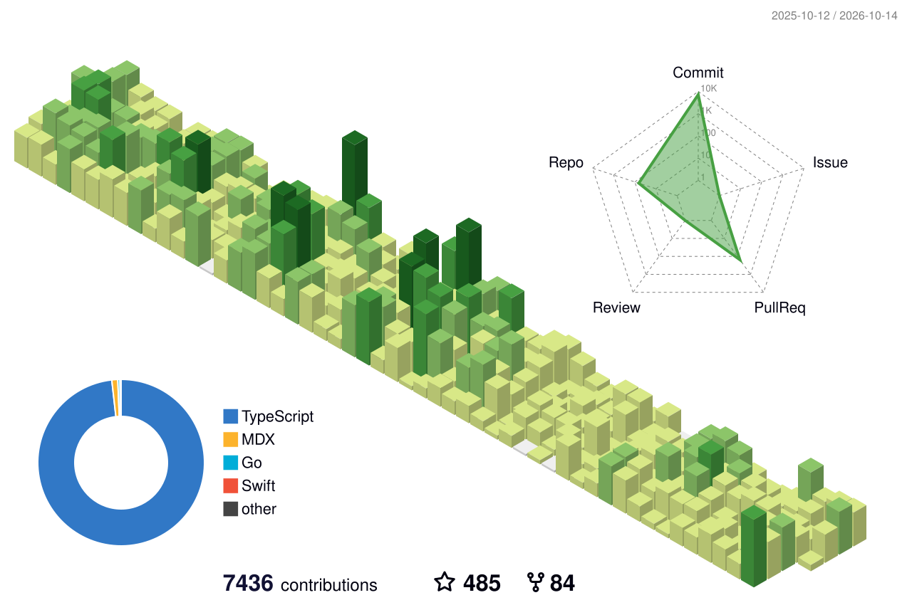

### Hi there 👋



 

[](https://github.com/anuraghazra/github-readme-stats)


 

<!--START_SECTION:waka-->


**🐱 My GitHub Data** 

> 📦 2.9 MB Used in GitHub's Storage 
 > 
> 🏆 6,047 Contributions in the Year 2026
 > 
> 🚫 Not Opted to Hire
 > 
> 📜 76 Public Repositories 
 > 
> 🔑 95 Private Repositories 
 > 
**I'm an Early 🐤** 

```text
🌞 Morning                8426 commits        ██░░░░░░░░░░░░░░░░░░░░░░░   08.94 % 
🌆 Daytime                49344 commits       █████████████░░░░░░░░░░░░   52.36 % 
🌃 Evening                28367 commits       ████████░░░░░░░░░░░░░░░░░   30.10 % 
🌙 Night                  8095 commits        ██░░░░░░░░░░░░░░░░░░░░░░░   08.59 % 
```
📅 **I'm Most Productive on Monday** 

```text
Monday                   21199 commits       ██████░░░░░░░░░░░░░░░░░░░   22.50 % 
Tuesday                  20103 commits       █████░░░░░░░░░░░░░░░░░░░░   21.33 % 
Wednesday                12750 commits       ███░░░░░░░░░░░░░░░░░░░░░░   13.53 % 
Thursday                 14265 commits       ████░░░░░░░░░░░░░░░░░░░░░   15.14 % 
Friday                   16188 commits       ████░░░░░░░░░░░░░░░░░░░░░   17.18 % 
Saturday                 4924 commits        █░░░░░░░░░░░░░░░░░░░░░░░░   05.23 % 
Sunday                   4803 commits        █░░░░░░░░░░░░░░░░░░░░░░░░   05.10 % 
```


📊 **This Week I Spent My Time On** 

```text
🕑︎ Time Zone: Asia/Shanghai

💬 Programming Languages: 
No Activity Tracked This Week

🔥 Editors: 
No Activity Tracked This Week

💻 Operating System: 
No Activity Tracked This Week
```

🤖 **AI Coding This Week** 

```text
No AI Coding Activity Tracked This Week
```


 Last Updated on 31/10/2026 04:25:20 UTC
<!--END_SECTION:waka-->
