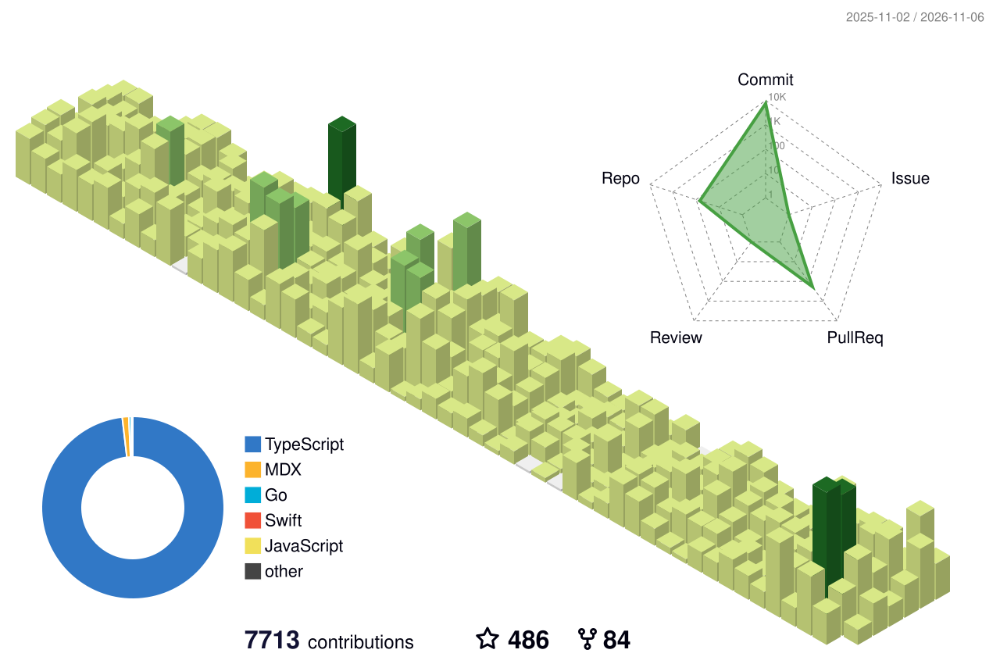

### Hi there 👋



 

[](https://github.com/anuraghazra/github-readme-stats)


 

<!--START_SECTION:waka-->


**🐱 My GitHub Data** 

> 📦 2.9 MB Used in GitHub's Storage 
 > 
> 🏆 6,047 Contributions in the Year 2026
 > 
> 🚫 Not Opted to Hire
 > 
> 📜 76 Public Repositories 
 > 
> 🔑 95 Private Repositories 
 > 
**I'm an Early 🐤** 

```text
🌞 Morning                8232 commits        ██░░░░░░░░░░░░░░░░░░░░░░░   08.89 % 
🌆 Daytime                48815 commits       █████████████░░░░░░░░░░░░   52.72 % 
🌃 Evening                27791 commits       ████████░░░░░░░░░░░░░░░░░   30.02 % 
🌙 Night                  7748 commits        ██░░░░░░░░░░░░░░░░░░░░░░░   08.37 % 
```
📅 **I'm Most Productive on Monday** 

```text
Monday                   21007 commits       ██████░░░░░░░░░░░░░░░░░░░   22.69 % 
Tuesday                  19869 commits       █████░░░░░░░░░░░░░░░░░░░░   21.46 % 
Wednesday                12424 commits       ███░░░░░░░░░░░░░░░░░░░░░░   13.42 % 
Thursday                 14034 commits       ████░░░░░░░░░░░░░░░░░░░░░   15.16 % 
Friday                   15984 commits       ████░░░░░░░░░░░░░░░░░░░░░   17.26 % 
Saturday                 4661 commits        █░░░░░░░░░░░░░░░░░░░░░░░░   05.03 % 
Sunday                   4607 commits        █░░░░░░░░░░░░░░░░░░░░░░░░   04.98 % 
```


📊 **This Week I Spent My Time On** 

```text
🕑︎ Time Zone: Asia/Shanghai

💬 Programming Languages: 
No Activity Tracked This Week

🔥 Editors: 
No Activity Tracked This Week

💻 Operating System: 
No Activity Tracked This Week
```

🤖 **AI Coding This Week** 

```text
No AI Coding Activity Tracked This Week
```


 Last Updated on 01/11/2026 04:42:33 UTC
<!--END_SECTION:waka-->
